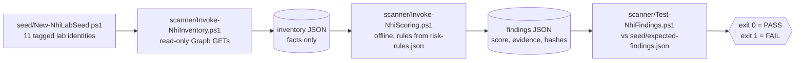

# NHI Governance Toolkit

A read-only governance toolkit for non-human identities (app registrations and service principals) in Microsoft Entra ID. It **finds** them, **scores** each against documented rules, **fixes** the worst pattern (stored client secrets) with GitHub Actions OIDC federation, and **maps** every finding to NIST SP 800-53 controls. Built and measured on a lab tenant, never production.



Short view. [`docs/architecture.md`](docs/architecture.md) has four diagrams: the read-only pipeline, the write path with its human checkpoints, the Phase 5 OIDC federation flow, and the Entra Agent ID model.

## Why

The lab tenant holds **101 non-human identities**: 84 are Microsoft's own and 17 are this tenant's, all of them seeded for this project (11 app registrations, 2 agent blueprints, 4 agent identities). A secret added directly to a service principal never appears if you look only at app registrations, and an agent's credential can sit on a different object from its permissions. This toolkit inventories both objects, scores what it finds, and checks its own scoring against a known answer key.

## Results

Latest scan, inventory `20261021-021751Z`:

| | |
|---|---|
| Identities scored | **101** (including 2 Entra Agent ID blueprints and 4 agent identities); **10** have findings |
| Self-check | **17 seeds** match the answer key, all **10 score constraints** hold: `RESULT: PASS` |
| Tests | **120 Pester tests** on synthetic inventories, no tenant needed, mutation-checked |
| Remediation | `seed-02-longsecret`: client secret replaced by OIDC federation, score **20 to 0**, `appidacr` 2 proof |

## Three things worth reading

**1. Risk that sits on two objects.** An agent identity has no credentials of its own: its blueprint holds a secret and exchanges it for the agent's token. Scored one identity at a time, the blueprint has "a secret" (NHI-009) and the agent has `Mail.ReadWrite` (NHI-004): two findings that look unrelated. **COMBO-U3** links them through the parent link and adds 15 to the blueprint, so it scores **40** and ranks second of 101. A harmless sibling agent keeps no finding. See [`docs/risk-model.md`](docs/risk-model.md) section 9.

**2. A live finding, and why the fix is the stronger trust.** The first federated credential used the classic name-based subject and the workflow failed with AADSTS700213: GitHub now sends an *immutable* subject (`repo:<owner>@<id>/<repo>@<id>:...`) for repositories created after 2026-07-15. Replacing the credential with the immutable form is also the better trust, because names can be recycled and numeric IDs cannot. The federated path has four locks: the exact immutable subject, a main-only branch rule on the `lab` environment, a required reviewer (administrator bypass off), and a `workflow_dispatch`-only trigger. Only after the federated login worked (`idtyp` app, `appidacr` 2) was the secret deleted. See [`docs/risk-model.md`](docs/risk-model.md) section 10 and [`examples/seed-02-before.json`](examples/seed-02-before.json) / [`seed-02-after.json`](examples/seed-02-after.json).

**3. The toolkit tests itself.** A hand-written answer key (`seed/expected-findings.json`) says what each seeded identity must produce, and the validator compares it with the findings. Rules read the scan's own start time, never the wall clock, and each findings file records the SHA-256 of its inputs. Re-run on 2026-10-21: scoring engine 0.2.0 on inventory `20261021-021751Z`, run twice into separate folders, gave byte-identical findings files (SHA-256 `eee1124f303943f10ae9e965660750d641e557cede9189b7d2af6bf36a3f62a2`), the same hash as the findings file from the live scan. Demo: `seed-03-expiring` has a 1-day secret; scored before it expired it gets NHI-007 and **10** points, after it NHI-003 and **3**, and it was the only identity whose result changed. See [`examples/`](examples/).

## Governance and evidence

The rules map to four NIST SP 800-53 Rev. 5 base controls: **AC-2** (NHI-001, 003, 010, 011; NHI-006 is deferred), **AC-6** (NHI-004, 005, 008 and the combination uplifts), **IA-5** (NHI-002, 003, 007, 009 and the Phase 5 federation) and **CM-8** (the inventory itself).

- **Evidence produced:** the inventory (every identity with `ownerType`, `identityType`, owners, sponsors, parent links, credential metadata, permissions, `scanMetadata` counts) and the findings (rule ID, severity, points, NIST control and per-credential or per-permission evidence), tied together by SHA-256 hashes of the inventory and rules. No secret value is ever read or stored.
- **Re-performance:** an auditor checks the two hashes, re-runs the scoring engine on the same inventory, and runs the validator, which re-hashes before judging. The original lab inventory contains tenant data and is not in the repo, so outsiders can re-perform on the synthetic inventories in `tests/`.
- **Reading it correctly:** this **provides evidence for** the controls, point-in-time and for a lab tenant; it is **not a compliance attestation**. The AC-6 rules are indicators that a permission is commonly high-risk, not proof that access is unnecessary.

Clause-by-clause mapping, limitations and gaps per control: [`docs/controls-mapping.md`](docs/controls-mapping.md).

## Rules

| ID | Finding | Severity | NIST 800-53 |
|----|---------|----------|-------------|
| NHI-001 | No owner / sponsor | Medium | AC-2 |
| NHI-002 | Client secret lifetime over 180 days | Medium | IA-5 |
| NHI-003 | Expired credential still attached | Low | IA-5, AC-2 |
| NHI-004 | High-risk application permission granted | Critical or High (by permission) | AC-6 |
| NHI-005 | Privileged directory role assigned to a service principal | Critical | AC-6 |
| NHI-006 | No sign-in in 90+ days | Medium, **deferred** (not scored) | AC-2 |
| NHI-007 | Active client secret in use | Medium | IA-5 |
| NHI-008 | Tenant-wide consent to a high-risk delegated permission | Low | AC-6 |
| NHI-009 | Active client secret on an Entra Agent ID blueprint | High | IA-5 |
| NHI-010 | Agent blueprint has no enabled sponsor | Medium | AC-2 |
| NHI-011 | Agent identity has no enabled sponsor | Medium | AC-2 |

## Scoring

Scores are additive by severity tier: Critical 40, High 25, Medium 10, Low 3, with no cap. Each rule fires at most once per identity. One combination uplift, **COMBO-U1 "armed privilege"**, adds 15 when an identity has a dangerous permission or role (NHI-004 or NHI-005) **and** an active client secret (NHI-007): a powerful identity that also has a working secret is exploitable right now; an expired secret does not qualify. An uplift for "ownerless plus privilege" was considered and rejected as a governance gap, not extra exploitability. Every weight and its reasoning is in [`docs/risk-model.md`](docs/risk-model.md).

**Entra Agent ID (Phase 4).** An agent identity has no credentials of its own: its blueprint holds them and exchanges them for the agent's tokens. That splits "armed privilege" across two records (secret on the blueprint, permission on the agent), so a per-identity score misses it. **COMBO-U3** adds 15 to a blueprint that has an active secret (NHI-009) when any of its agents holds a high-risk permission or privileged role. Agents are judged on sponsors rather than owners, inherit their blueprint's owner type, and each blueprint lists its agent count and worst agent as context. Details and lab evidence (including a permission Entra refused to grant an agent) are in [`docs/risk-model.md`](docs/risk-model.md) section 9.

## Design decisions

- **Read-only by code.** Every Graph call in the scanner goes through one function that hard-codes `-Method GET`, and the scanner requests only read scopes. Honest caveat: the delegated token can still carry write scopes, because Entra reuses the existing consent grant of the "Microsoft Graph Command Line Tools" app. The scanner records `writeScopesPresent` and a warning in the inventory when that happens; it never uses them.
- **Credentials from both objects.** Secrets and certificates are read from the app registration *and* the service principal. A secret added directly to a service principal is invisible if you only look at app registrations (seed-11 is the regression test).
- **IDs, never display names.** Graph is matched by its well-known appId, privileged roles by role template ID, and seeds by the `nhi-lab-seed` tag. A look-alike service principal named "Microsoft Graph" does not match.
- **Scan-start clock.** Rules evaluate against the inventory's `scanStartUtc`, never the current time, so the same inventory always yields the same findings. The output carries no generation timestamp and records SHA-256 hashes of its inputs.
- **Facts in the scanner, judgments in the engine.** The scanner records what exists; the scoring engine decides what is risky, offline, from `risk-rules.json`.

## Quick start

**Prerequisites:** PowerShell 7+; the Microsoft Graph PowerShell SDK (v2); Pester 5.x (`Install-Module Pester -Scope CurrentUser -SkipPublisherCheck -MaximumVersion 5.99.99`); Entra ID P1/P2 for sign-in activity data (otherwise pass `-SkipSignInActivity` to the scanner).

**Scanner scopes (delegated, interactive sign-in only):** `Application.Read.All`, `Directory.Read.All`, `RoleManagement.Read.Directory`, `AuditLog.Read.All`.

```powershell
# 1. Scan (signs in interactively; writes output/inventory-<timestamp>.json)
pwsh scanner/Invoke-NhiInventory.ps1

# 2. Score (offline; writes output/findings-<timestamp>.json)
pwsh scanner/Invoke-NhiScoring.ps1 -InventoryPath output/inventory-<timestamp>.json

# 3. Validate against the seed answer key (exit 0 = pass, 1 = fail)
pwsh scanner/Test-NhiFindings.ps1 -FindingsPath output/findings-<timestamp>.json -InventoryPath output/inventory-<timestamp>.json

# Tests (no tenant required)
pwsh tests/Invoke-Tests.ps1
```

Step 3 only applies to a tenant that was seeded; on any other tenant, use steps 1 and 2.

## Lab warning

`seed/New-NhiLabSeed.ps1` deliberately creates risky identities (an ownerless app, a 2-year secret, apps granted `Directory.ReadWrite.All` and `RoleManagement.ReadWrite.Directory`, a service principal holding Application Administrator). It needs write scopes and changes the tenant. **Use a dedicated test tenant only, never production.** Run it with `-WhatIf` first. `seed/Remove-NhiLabSeed.ps1` removes only objects tagged `nhi-lab-seed` (and carrying the matching `notes`). Agent ID objects have no `notes`, so `seed/Remove-AgentIdSeed.ps1` removes those instead: blueprints tagged `nhi-lab-seed` and the agents whose parent blueprint is one of them. The seeder discards each secret as it is created; no secret value is stored or printed.

## Scope

- A **lab tenant**, one point in time. Not a production design and not a compliance attestation.
- Findings are indicators for review. They do not prove a control is met or failed.
- Entra Agent ID coverage is inventory, sponsors and permissions only; agent Conditional Access and ID Protection need licensing the lab does not have.

## Known limitations

- NHI-006 (no sign-in in 90+ days) is deferred: how to treat a null sign-in value is undecided.
- NHI-005 counts **Active** role assignments only; Eligible (PIM) assignments are not scored. Whether service principals can self-activate eligible roles via the API is an open research item.
- The NHI-005 role list (5 roles) and the NHI-004 High-tier and NHI-008 scope lists are hand-maintained; the High tier is an unresearched project convention.
- NHI-008 covers tenant-wide (`AllPrincipals`) grants only. Per-user grants of critical delegated scopes are considered and deferred.
- Severity tiers, point values and the 180-day secret threshold are this project's own conventions, not an external standard.
- Findings reflect only what the inventory captured. Tested on a single small lab tenant.

Full list: [`docs/risk-model.md`](docs/risk-model.md) section 6 and [`TODO.md`](TODO.md).

## Repo layout

```
.
├── README.md  LICENSE  TODO.md
├── seed/
│   ├── New-NhiLabSeed.ps1        # creates 11 tagged lab identities (writes to the tenant)
│   ├── New-AgentIdSeed.ps1       # Phase 4: 2 agent blueprints + 4 agent identities (writes)
│   ├── Remove-NhiLabSeed.ps1     # removes only objects tagged nhi-lab-seed
│   ├── Remove-AgentIdSeed.ps1    # Phase 4: removes the agent seeds (tag + parent link; -Purge opt-in)
│   └── expected-findings.json    # answer key + score constraints
├── scanner/
│   ├── Invoke-NhiInventory.ps1   # read-only inventory -> JSON
│   ├── Invoke-NhiScoring.ps1     # offline scoring engine -> findings JSON
│   ├── Test-NhiFindings.ps1      # validator against the answer key
│   └── risk-rules.json           # rules, tiers, uplift, NIST mapping
├── .github/workflows/oidc-demo.yml  # Phase 5: manual OIDC login proof (no secret)
├── remediation/
│   ├── Add-NhiFederatedCredential.ps1  # Phase 5: adds or updates the GitHub FIC (writes; -WhatIf first)
│   └── Remove-NhiAppSecret.ps1   # Phase 5: deletes one secret, only if the FIC exists
├── tests/                        # Pester 5, synthetic inventories
├── examples/                     # sanitized before/after outputs
└── docs/
    ├── architecture.md           # four Mermaid diagrams
    ├── controls-mapping.md       # rules and evidence mapped to AC-2, AC-6, IA-5, CM-8
    └── risk-model.md             # why each rule and weight exists
```

## Roadmap

All six phases are done: inventory, scoring, Entra Agent ID, OIDC remediation, controls mapping and architecture, and this write-up. Open work is tracked in [`TODO.md`](TODO.md):

- A scanner rule for broad or mutable GitHub federated-credential subjects (the scanner records the facts today, no rule judges them).
- NHI-006 (no sign-in in 90+ days), deferred until the null sign-in treatment is decided.
- Researching the hand-maintained permission and role lists.

<details>
<summary>History: per-phase results</summary>

- **Phase 5 (inventory `20261021-021751Z`):** `seed-02-longsecret` went from a 730-day client secret (NHI-002 + NHI-007, score 20) to no secret and one GitHub Actions federated credential, score 0. The validator resolves its state as `federated` (no secret, and a credential matching issuer, immutable subject and audience exactly). Identities with findings went 11 to 10; nothing else changed. Workflow run `oidc-demo #2` printed `idtyp` app, `appidacr` 2 and `appid` match true.
- **Phase 4 (inventory `20261019-231744Z`):** 101 identities scored, including 2 blueprints and 4 agent identities; 17 seeds and all 10 constraints held. 117 Pester tests. The risky blueprint scored 40 (NHI-009 25 + COMBO-U3 15).
- **Phase 3 (inventory `20261012-130643Z`):** 89 identities scored (89 service principals, 11 of which also have an app registration); 11 seeded identities; 9 identities had findings, all 9 seeds. 7 of 8 rules active (NHI-006 deferred). All 11 seeds matched the answer key and all 7 score constraints held. 52 Pester tests.
- **Mutation checks:** loosening the NHI-002 boundary, the NHI-003 expiry comparison, the resolved-appId check, or the ordinal output ordering each makes tests fail.

</details>

## How this was built

Built with Claude Code as an assistant. All design decisions are mine and are documented with their reasons in [`docs/risk-model.md`](docs/risk-model.md).

## License

[MIT](LICENSE)
