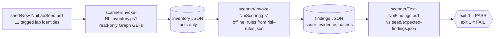

# NHI Governance Toolkit

A read-only governance toolkit for non-human identities (app registrations and service principals) in Microsoft Entra ID. It inventories every one, including the credentials hidden on service principals that app-registration-only tooling misses, scores each against documented rules mapped to NIST SP 800-53, and checks its own results against a deliberately seeded answer key.



## Results

Current (Phase 5), measured on the lab tenant (inventory `20261021-021751Z`):

- **Phase 5, secret replaced by federation:** `seed-02-longsecret` went from a 730-day client secret (NHI-002 + NHI-007, score **20**) to **no secret** and a GitHub Actions OIDC federated credential, score **0**. The validator resolves its state as `federated` (no secret, and a credential matching issuer, immutable subject and audience exactly) and prints `RESULT: PASS` (17 seeds, C1-C8). Identities with findings went 11 to 10; nothing else changed. Proof the federation works: workflow run `oidc-demo #2` logged in with `idtyp` = app, `appidacr` = 2 (the token was proved by a federated assertion, not a secret) and `appid` matching. See [`examples/seed-02-before.json`](examples/seed-02-before.json) and [`examples/seed-02-after.json`](examples/seed-02-after.json).
- **Lab finding:** the first federated credential used the classic name-based subject and failed with AADSTS700213, because GitHub now sends an *immutable* subject (`repo:<owner>@<id>/<repo>@<id>:...`) for repositories created after 2026-07-15. The credential was replaced with the immutable form, which is also the stronger trust: names can be recycled, numeric IDs cannot. See [`docs/risk-model.md`](docs/risk-model.md) section 10.
- **Four locks on the federated path:** (1) the exact immutable FIC subject (owner and repo IDs plus `environment:lab`, no wildcards); (2) a main-only deployment branch rule on the `lab` environment; (3) a required reviewer (`Demo411`) on `lab`; (4) a `workflow_dispatch`-only trigger, so the workflow runs only when someone starts it by hand.
- **101 identities** scored, including 2 agent blueprints and 4 agent identities (Entra Agent ID). **17 seeded identities** match the answer key and all **10 score constraints** hold: `RESULT: PASS`.
- The risky blueprint (an active client secret above an agent holding `Mail.ReadWrite`) scores **40** (NHI-009 25 + COMBO-U3 15) and ranks second of all identities.
- **120 Pester tests** on synthetic inventories (no tenant needed), **mutation-checked**: loosening the NHI-002 boundary, the NHI-003 expiry comparison, the resolved-appId check, or the ordinal output ordering each makes tests fail.
- **History (Phase 3, inventory `20261012-130643Z`):** 89 identities scored (89 service principals, 11 of which also have an app registration); 11 seeded identities; 9 identities had findings, all 9 seeds. 7 of 8 rules active (NHI-006 deferred). All 11 seeds matched the answer key and all 7 score constraints held. 52 Pester tests.
- **Reproducibility demo:** `seed-03-expiring` has a 1-day secret. Scored on a scan taken before it expired it gets NHI-007 and **10** points; scored on a later scan it gets NHI-003 and **3**. Re-running the engine on the same inventory gives a findings file with the identical SHA-256, and across the two findings files `seed-03-expiring` was the only identity whose rules or score changed. See [`examples/`](examples/).

## Rules

| ID | Finding | Severity | NIST 800-53 |
|----|---------|----------|-------------|
| NHI-001 | No owner / sponsor | Medium | AC-2 |
| NHI-002 | Client secret lifetime over 180 days | Medium | IA-5 |
| NHI-003 | Expired credential still attached | Low | IA-5, AC-2 |
| NHI-004 | High-risk application permission granted | Critical or High (by permission) | AC-6 |
| NHI-005 | Privileged directory role assigned to a service principal | Critical | AC-6 |
| NHI-006 | No sign-in in 90+ days | Medium, **deferred** (not scored) | AC-2 |
| NHI-007 | Active client secret in use | Medium | IA-5 |
| NHI-008 | Tenant-wide consent to a high-risk delegated permission | Low | AC-6 |
| NHI-009 | Active client secret on an Entra Agent ID blueprint | High | IA-5 |
| NHI-010 | Agent blueprint has no enabled sponsor | Medium | AC-2 |
| NHI-011 | Agent identity has no enabled sponsor | Medium | AC-2 |

## Scoring

Scores are additive by severity tier: Critical 40, High 25, Medium 10, Low 3, with no cap. Each rule fires at most once per identity. One combination uplift, **COMBO-U1 "armed privilege"**, adds 15 when an identity has a dangerous permission or role (NHI-004 or NHI-005) **and** an active client secret (NHI-007): a powerful identity that also has a working secret is exploitable right now; an expired secret does not qualify. An uplift for "ownerless plus privilege" was considered and rejected as a governance gap, not extra exploitability. Every weight and its reasoning is in [`docs/risk-model.md`](docs/risk-model.md).

**Entra Agent ID (Phase 4).** An agent identity has no credentials of its own: its blueprint holds them and exchanges them for the agent's tokens. That splits "armed privilege" across two records (secret on the blueprint, permission on the agent), so a per-identity score misses it. **COMBO-U3** adds 15 to a blueprint that has an active secret (NHI-009) when any of its agents holds a high-risk permission or privileged role. Agents are judged on sponsors rather than owners, inherit their blueprint's owner type, and each blueprint lists its agent count and worst agent as context. Details and lab evidence (including a permission Entra refused to grant an agent) are in [`docs/risk-model.md`](docs/risk-model.md) section 9.

## Design decisions

- **Read-only by code.** Every Graph call in the scanner goes through one function that hard-codes `-Method GET`, and the scanner requests only read scopes. Honest caveat: the delegated token can still carry write scopes, because Entra reuses the existing consent grant of the "Microsoft Graph Command Line Tools" app. The scanner records `writeScopesPresent` and a warning in the inventory when that happens; it never uses them.
- **Credentials from both objects.** Secrets and certificates are read from the app registration *and* the service principal. A secret added directly to a service principal is invisible if you only look at app registrations (seed-11 is the regression test).
- **IDs, never display names.** Graph is matched by its well-known appId, privileged roles by role template ID, and seeds by the `nhi-lab-seed` tag. A look-alike service principal named "Microsoft Graph" does not match.
- **Scan-start clock.** Rules evaluate against the inventory's `scanStartUtc`, never the current time, so the same inventory always yields the same findings. The output carries no generation timestamp and records SHA-256 hashes of its inputs.
- **Facts in the scanner, judgments in the engine.** The scanner records what exists; the scoring engine decides what is risky, offline, from `risk-rules.json`.

## Quick start

**Prerequisites:** PowerShell 7+; the Microsoft Graph PowerShell SDK (v2); Pester 5.x (`Install-Module Pester -Scope CurrentUser -SkipPublisherCheck -MaximumVersion 5.99.99`); Entra ID P1/P2 for sign-in activity data (otherwise pass `-SkipSignInActivity` to the scanner).

**Scanner scopes (delegated, interactive sign-in only):** `Application.Read.All`, `Directory.Read.All`, `RoleManagement.Read.Directory`, `AuditLog.Read.All`.

```powershell
# 1. Scan (signs in interactively; writes output/inventory-<timestamp>.json)
pwsh scanner/Invoke-NhiInventory.ps1

# 2. Score (offline; writes output/findings-<timestamp>.json)
pwsh scanner/Invoke-NhiScoring.ps1 -InventoryPath output/inventory-<timestamp>.json

# 3. Validate against the seed answer key (exit 0 = pass, 1 = fail)
pwsh scanner/Test-NhiFindings.ps1 -FindingsPath output/findings-<timestamp>.json -InventoryPath output/inventory-<timestamp>.json

# Tests (no tenant required)
pwsh tests/Invoke-Tests.ps1
```

Step 3 only applies to a tenant that was seeded; on any other tenant, use steps 1 and 2.

## Lab warning

`seed/New-NhiLabSeed.ps1` deliberately creates risky identities (an ownerless app, a 2-year secret, apps granted `Directory.ReadWrite.All` and `RoleManagement.ReadWrite.Directory`, a service principal holding Application Administrator). It needs write scopes and changes the tenant. **Use a dedicated test tenant only, never production.** Run it with `-WhatIf` first. `seed/Remove-NhiLabSeed.ps1` removes only objects tagged `nhi-lab-seed` (and carrying the matching `notes`). Agent ID objects have no `notes`, so `seed/Remove-AgentIdSeed.ps1` removes those instead: blueprints tagged `nhi-lab-seed` and the agents whose parent blueprint is one of them. The seeder discards each secret as it is created; no secret value is stored or printed.

## Known limitations

- NHI-006 (no sign-in in 90+ days) is deferred: how to treat a null sign-in value is undecided.
- NHI-005 counts **Active** role assignments only; Eligible (PIM) assignments are not scored. Whether service principals can self-activate eligible roles via the API is an open research item.
- The NHI-005 role list (5 roles) and the NHI-004 High-tier and NHI-008 scope lists are hand-maintained; the High tier is an unresearched project convention.
- NHI-008 covers tenant-wide (`AllPrincipals`) grants only. Per-user grants of critical delegated scopes are considered and deferred.
- Severity tiers, point values and the 180-day secret threshold are this project's own conventions, not an external standard.
- Findings reflect only what the inventory captured. Tested on a single small lab tenant.

Full list: [`docs/risk-model.md`](docs/risk-model.md) section 6 and [`TODO.md`](TODO.md).

## Repo layout

```
.
├── README.md  LICENSE  TODO.md
├── seed/
│   ├── New-NhiLabSeed.ps1        # creates 11 tagged lab identities (writes to the tenant)
│   ├── New-AgentIdSeed.ps1       # Phase 4: 2 agent blueprints + 4 agent identities (writes)
│   ├── Remove-NhiLabSeed.ps1     # removes only objects tagged nhi-lab-seed
│   ├── Remove-AgentIdSeed.ps1    # Phase 4: removes the agent seeds (tag + parent link; -Purge opt-in)
│   └── expected-findings.json    # answer key + score constraints
├── scanner/
│   ├── Invoke-NhiInventory.ps1   # read-only inventory -> JSON
│   ├── Invoke-NhiScoring.ps1     # offline scoring engine -> findings JSON
│   ├── Test-NhiFindings.ps1      # validator against the answer key
│   └── risk-rules.json           # rules, tiers, uplift, NIST mapping
├── .github/workflows/oidc-demo.yml  # Phase 5: manual OIDC login proof (no secret)
├── remediation/
│   ├── Add-NhiFederatedCredential.ps1  # Phase 5: adds the GitHub FIC (writes; -WhatIf first)
│   └── Remove-NhiAppSecret.ps1   # Phase 5: deletes one secret, only if the FIC exists
├── tests/                        # Pester 5, synthetic inventories
├── examples/                     # sanitized before/after outputs
└── docs/risk-model.md            # why each rule and weight exists
```

## Roadmap

- **Phase 4 (done):** Entra Agent ID. 2 blueprints and 4 agent identities seeded, inventoried with sponsors and parent links, scored (NHI-009/010/011, COMBO-U3) and validated: live inventory `20261019-231744Z`, `RESULT: PASS`.
- **Phase 5 (done):** `seed-02-longsecret`'s client secret replaced by GitHub Actions OIDC federation, secret deleted, re-scanned: score 20 to 0, validator `RESULT: PASS`, `appidacr` 2 proof. Future work: rules for broad or mutable GitHub FIC subjects.
- **Phase 6:** controls mapping, architecture diagram, write-up.

## How this was built

Developed with Claude Code as an AI pair-programmer; the design decisions, the risk model and the review are the project owner's.

## License

[MIT](LICENSE)
