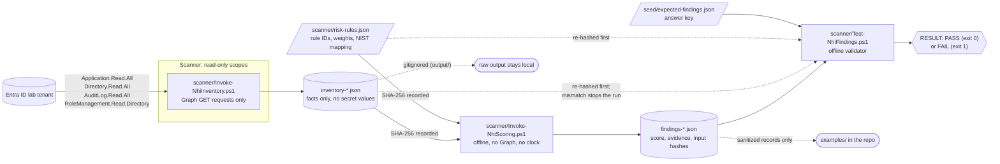
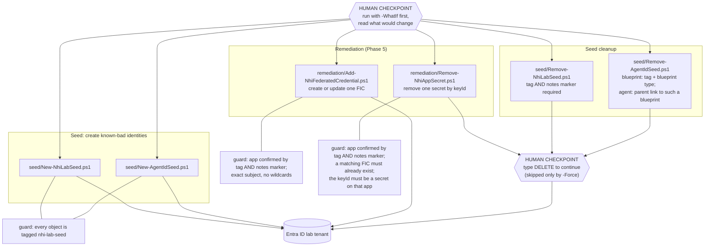
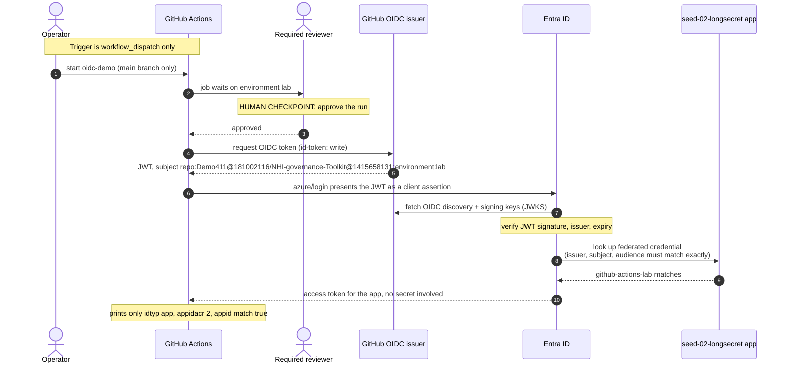
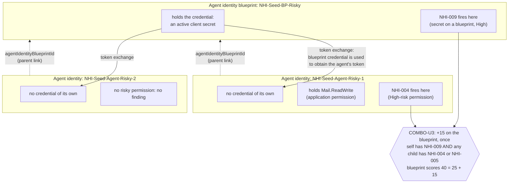

# Architecture

Four diagrams, each making one point. All are Mermaid, so GitHub renders them from this file and they diff as text.

| # | Diagram | The point |
|---|---------|-----------|
| 1 | [Read-only pipeline](#1-the-read-only-pipeline) | The scanner only reads; every hand-off is hash-bound |
| 2 | [Write path](#2-the-write-path-the-only-scripts-that-change-the-tenant) | Only four seed scripts and two remediation scripts change the tenant, and each has a guard |
| 3 | [Phase 5 federation flow](#3-phase-5-github-actions-oidc-federation) | How a stored secret was replaced by a federated login |
| 4 | [Agent ID model](#4-the-entra-agent-id-model) | Why a credential on one object and a permission on another still count as one risk |

Scope: a lab tenant, as everywhere in this repo. Component-to-control links are in [`controls-mapping.md`](controls-mapping.md); rule and weight reasoning is in [`risk-model.md`](risk-model.md).

---

## 1. The read-only pipeline

What to notice:

- **Read-only is enforced twice.** The scanner requests only the four read scopes above, and it drops any cached Graph session first so a leftover session from a write script cannot carry write scopes into a scan. If the token still holds write-capable scopes (they can come from an existing consent grant on the Microsoft Graph Command Line Tools app), the scan records a warning in `scanMetadata.warnings` instead of hiding it.
- **Scoring and validating need no tenant.** `Invoke-NhiScoring.ps1` and `Test-NhiFindings.ps1` read local files only. The engine never reads the wall clock; it uses the inventory's `scanStartUtc`, so the same inputs give the same findings.
- **The hash chain.** The findings file records the SHA-256 of the inventory and of `risk-rules.json`. The validator re-hashes both before judging anything and refuses to continue if either differs.
- **The validator is a separate check.** It compares findings to a hand-written answer key (`seed/expected-findings.json`), which is how the toolkit tests its own scoring.
- **What the scanner also reads** (inside the same read scopes): app registrations and service principals, their credentials (metadata only), permissions, directory roles, consents, federated credentials, and the Entra Agent ID blueprints and agent identities with their sponsors and parent links (diagram 4).

---

## 2. The write path: the only scripts that change the tenant

What to notice:

- **Everything that writes is here, and none of it is the scanner.** The scanner, scorer and validator never write; they are diagram 1.
- **Preview first.** All six scripts support `-WhatIf`. Under `-WhatIf`, the remediation scripts request only `Application.Read.All`, so a dry run needs no write consent.
- **Typing DELETE.** The two cleanup scripts and `Remove-NhiAppSecret.ps1` print exactly what will be removed and require typing `DELETE` (case-sensitive); `-Force` skips the prompt for scripted use. For `Remove-NhiAppSecret.ps1` that is two checkpoints in a row: read the `-WhatIf` preview (keyId, secret display name, the FIC it depends on), then type `DELETE`. The seed cleanup soft-deletes and then purges only the objects it collected, never "everything in the recycle bin".
- **Scope of deletion.** `Remove-NhiLabSeed.ps1` removes only objects carrying both the `nhi-lab-seed` tag and the notes marker. Agent ID objects have no `notes` property, so `Remove-AgentIdSeed.ps1` identifies a blueprint by the tag plus the blueprint type, and an agent by its parent link (`agentIdentityBlueprintId`) to such a blueprint, never by display name.
- **Order matters in remediation.** `Remove-NhiAppSecret.ps1` has its own guard and refuses to delete a secret unless the matching federated credential already exists, so the secret cannot be removed before its replacement is in place.
- **No secret is written anywhere.** Seeded secrets are created and their values discarded immediately; the scripts print key IDs and display names only.

---

## 3. Phase 5: GitHub Actions OIDC federation

What to notice:

- **Four locks stack up.** (1) The federated credential's subject is exact and immutable (owner and repo IDs plus `environment:lab`, no wildcards). (2) The `lab` environment accepts runs from `main` only. (3) The `lab` environment has a required reviewer, with administrator bypass switched off. (4) The workflow runs only on `workflow_dispatch`.
- **Entra verifies the token before it trusts any claim.** It fetches GitHub's OIDC discovery document and signing keys (JWKS), then checks the JWT's signature, issuer and expiry. Only after that does it compare issuer, subject and audience with the federated credential.
- **Immutable subject.** GitHub sends the `owner@id/repo@id` form for repositories created after 2026-07-15. The first, name-based credential failed with AADSTS700213 and was replaced. The numeric IDs cannot be recycled by another owner of the same name. See `risk-model.md` section 10.
- **Proof the login used federation.** `appidacr` 2 means the client authenticated without a shared secret. Run `oidc-demo #2` printed it.
- **Why the secret could then go.** Only after this login worked was the app's client secret removed (diagram 2, `Remove-NhiAppSecret.ps1`), which took `seed-02-longsecret` from score 20 to 0. Records: `examples/seed-02-before.json` and `examples/seed-02-after.json`.
- **Nothing sensitive is printed.** The workflow prints only the three claims above. The client ID and tenant ID are stored as environment secrets, and the token is never printed.

---

## 4. The Entra Agent ID model

What to notice:

- **The credential and the permission live on different objects.** Scored one identity at a time, the blueprint has "a secret" and the agent has "a mail permission": two separate findings that look unrelated (NHI-009 and NHI-004, both High). Because the blueprint's credential is exchanged for the agent's token, together they are armed privilege.
- **COMBO-U3 is the only cross-identity rule.** It runs in a second pass, after every identity has its own findings, and follows the parent link (`agentIdentityBlueprintId`, an ID, never a name). It adds +15 once on the blueprint, however many children qualify, and the evidence lists the qualifying children.
- **A harmless sibling is not penalised.** `Agent-Risky-2` shares the blueprint's credential but has no risky permission, so it keeps no finding. The agent roll-up (agent count, worst child) is context only and adds no points.
- **Accountability for these objects is a sponsor, not an owner.** NHI-010 (blueprint) and NHI-011 (agent) test for an enabled sponsor. Agents inherit their blueprint's `ownerType`.
- **Limits.** Agent Conditional Access and ID Protection are outside the scope of this lab (licensing). Details in [`risk-model.md`](risk-model.md) section 9.

---

## Component-to-control map

| Component | Role | Control evidence (see `controls-mapping.md`) |
|-----------|------|---------------------------------------------|
| `scanner/Invoke-NhiInventory.ps1` | Builds the inventory | CM-8 |
| `scanner/Invoke-NhiScoring.ps1` + `risk-rules.json` | Applies the rules | AC-2, AC-6, IA-5 |
| `scanner/Test-NhiFindings.ps1` + `expected-findings.json` | Checks the engine against an answer key | all four (re-performance) |
| `remediation/*.ps1` + `.github/workflows/oidc-demo.yml` | Replaces a stored secret with federation | IA-5 |
| `seed/*.ps1` | Creates and removes the known-bad test identities | none (test fixtures) |

## What these diagrams do not show

- Individual Graph endpoints and the per-rule logic: see the script headers and `risk-model.md`.
- Anything outside the lab tenant. This is not a production design.
